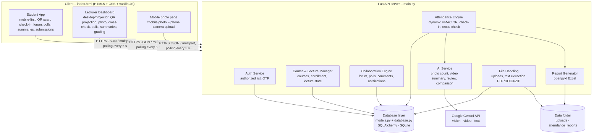
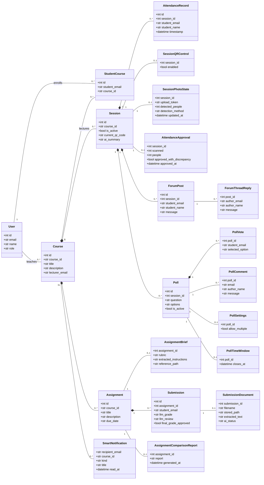

# System Architecture & UML Diagrams

## 1. Main Software Components
The SmartClass application is composed of several decoupled modules to ensure maintainability and adherence to the KISS principle:

1. **Client Application (`index.html`, HTML5 + CSS + JavaScript):**
   * *Student App:* Mobile-first interface for QR scanning (`html5-qrcode`), poll voting, forum participation, reading summaries and assignment submission.
   * *Lecturer Dashboard:* Desktop/projector interface for lecture management, dynamic QR projection, classroom photo, cross-check result, live poll charts, summaries and grading/comparison.
   * *Mobile photo page:* A small page opened by scanning a one-time QR, so the lecturer can take the classroom photo with a phone.
2. **API Gateway & Core Logic (Python FastAPI, `main.py`):**
   * *Auth Service:* Checks the institutional authorized list and issues/validates the OTP (120 s).
   * *Course & Lecture Manager:* Course creation (unique Course ID), enrollment, one active lecture per course.
   * *Collaboration Engine:* Lecture Q&A forum with threaded replies, KISS polls (live or time-limited) with comments, in-app notifications.
3. **Attendance Engine:**
   * Generates dynamic QR codes (HMAC of lecture ID + 10-second time slot).
   * Validates check-ins, locks them on SESSION END.
   * Sends the classroom photo to the **Gemini vision model** for a head count (the lecturer can correct it), runs the cross-check and the approval flow.
   * Generates the privacy-safe `.xlsx` report via `openpyxl`.
4. **AI & LLM Service (Google Gemini API):**
   * People counting in the classroom photo.
   * Lecture video summaries via the Gemini Files API (background job, up to 500 MB).
   * Assignment deep reviews with recommended grade, and lecturer-only comparative analysis.
   * Retries on 429/5xx and falls back to a secondary model; never fabricates results.
5. **Database Layer (SQLite via SQLAlchemy, PostgreSQL-ready):** Stores users, courses, lectures, attendance, polls, forum, assignments and submissions. Files (uploads, reports) live in the data folder (`SMARTCLASS_DATA_DIR`).

---

## 2. Low-Level Class Diagram

### 2.1 Original design (milestone 2)
*This diagram illustrates the core Object-Oriented Design (OOD) of the system as first designed.*

### 2.2 Implemented data model (final)
The implemented classes as they exist in `models.py` (core) and `main.py` (extensions added during development). Extensions were added as separate classes linked by foreign key, so the original tables stayed unchanged (Open/Closed principle).

### 2.3 Service functions (main.py)
The business logic is grouped in functions that act on the classes above:

| Responsibility | Main functions |
|---|---|
| Access control | `lecturer_course`, `member_course`, `lecturer_assignment`, `assignment_for_member` |
| Dynamic QR | `qr_at`, `get_qr_status`, `qr_enabled`, `lock_attendance` |
| Attendance cross-check | `count_people_from_image`, `attendance_crosscheck`, `write_attendance_report` |
| Polls | `poll_choices`, `poll_allows_multiple` |
| AI (Gemini) | `gemini_generate`, `gemini_grade`, `gemini_compare_assignments`, `run_video_summary_job` |
| Files | `store_upload`, `extract_document_text` |
| Notifications | `notify` |

Sequence diagrams of the main flows: see `Sequence Diagrams.md`.
