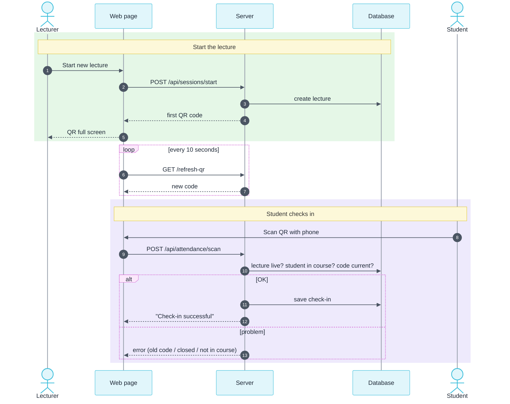
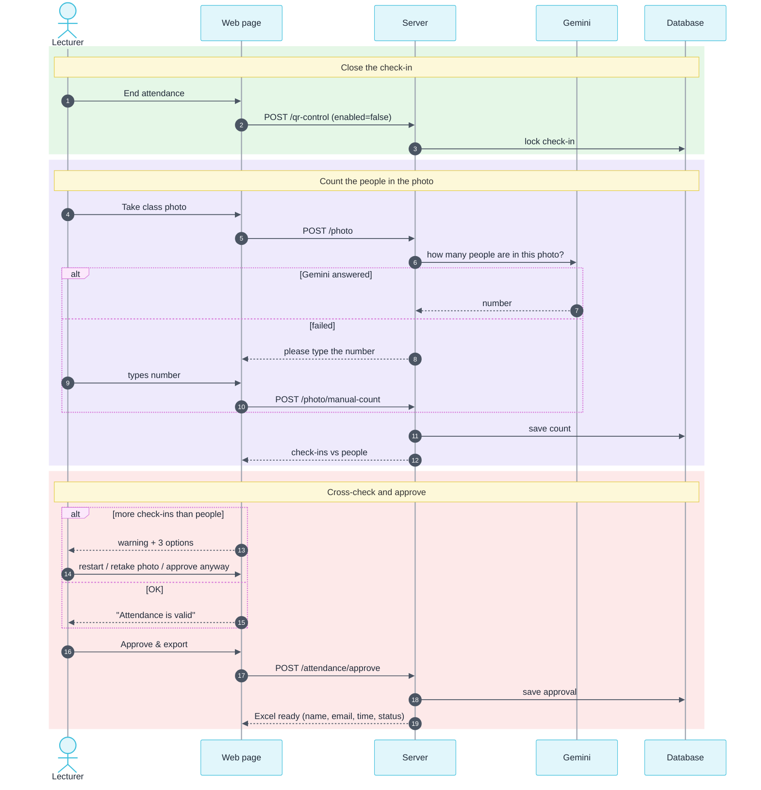
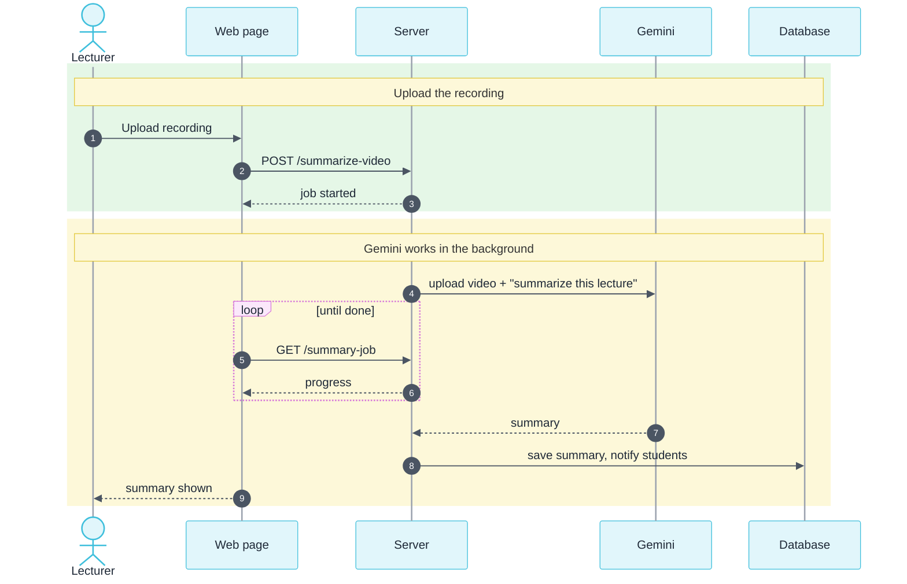
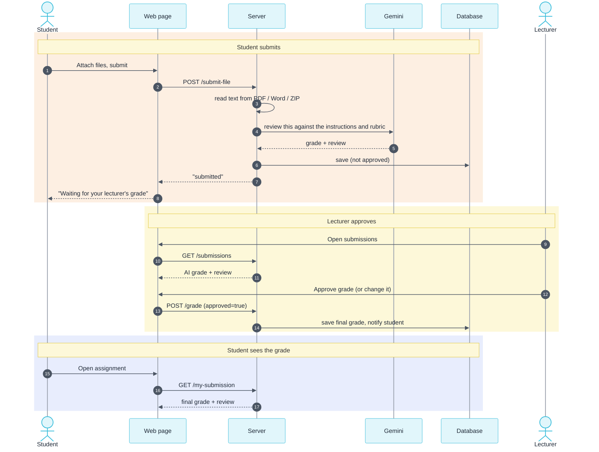

# Class & Sequence Diagrams

## 1. Class diagram

### First version (before coding)

### Final version (as implemented)
The core classes are in `models.py`. Classes we added later (photo count, approval, poll settings, lecture names…) are in `main.py`. We added them as new classes linked to the old ones instead of changing the old tables (Open/Closed principle).
The colors group the classes by feature: users and notifications in pink, courses in light blue, lectures in green, attendance in purple, forum in orange, polls in red, assignments in yellow, submissions in blue.

```mermaid
classDiagram
    direction TB

    class User {
        +String email
        +String name
        +String role
        +request_otp(email)
        +verify_otp(email, code)
    }
    class Course {
        +String course_id
        +String title
        +String description
        +String lecturer_email
        +create_course()
        +enroll_student(email)
    }
    class StudentCourse {
        +String student_email
        +String course_id
    }
    class Session {
        +Integer id
        +String course_id
        +Boolean is_active
        +String current_qr_code
        +Text ai_summary
        +start_session()
        +get_qr_status()
        +close_session()
    }
    class SessionTitle {
        +Integer session_id
        +String title
    }
    class SessionQRControl {
        +Integer session_id
        +Boolean enabled
        +lock_attendance()
    }
    class AttendanceRecord {
        +Integer session_id
        +String student_email
        +String student_name
        +DateTime timestamp
        +scan_attendance(qr_code)
    }
    class SessionPhotoState {
        +Integer session_id
        +Integer detected_people
        +String detection_method
        +count_people_from_image(photo)
    }
    class AttendanceApproval {
        +Integer session_id
        +Integer scanned
        +Integer people
        +Boolean approved_with_discrepancy
        +attendance_crosscheck()
        +write_attendance_report()
    }
    class ForumPost {
        +Integer session_id
        +String student_name
        +Text message
    }
    class ForumThreadReply {
        +Integer post_id
        +String author_name
        +Text message
    }
    class Poll {
        +Integer session_id
        +String question
        +Text options
        +Boolean is_active
        +poll_choices()
    }
    class PollSettings {
        +Integer poll_id
        +Boolean allow_multiple
    }
    class PollTimeWindow {
        +Integer poll_id
        +DateTime closes_at
    }
    class PollVote {
        +Integer poll_id
        +String student_email
        +String selected_option
    }
    class PollComment {
        +Integer poll_id
        +String author_name
        +Text message
    }
    class Assignment {
        +String course_id
        +String title
        +Text description
        +String due_date
    }
    class AssignmentBrief {
        +Integer assignment_id
        +Text rubric
        +Text extracted_instructions
        +String reference_name
    }
    class Submission {
        +Integer assignment_id
        +String student_email
        +String llm_grade
        +Text llm_review
        +Boolean final_grade_approved
        +review_submission()
        +review_for_response()
    }
    class SubmissionDocument {
        +Integer submission_id
        +String filename
        +Text extracted_text
        +String ai_status
        +extract_document_text()
    }
    class AssignmentComparisonReport {
        +Integer assignment_id
        +Text report
        +DateTime generated_at
        +gemini_compare_assignments()
    }
    class SmartNotification {
        +String recipient_email
        +String kind
        +String title
        +DateTime read_at
        +notify(emails)
    }

    User "1" --> "*" Course : Teaches
    User "1" --> "*" StudentCourse : Enrolled In
    User "1" --> "*" SmartNotification : Receives
    Course "1" *-- "*" StudentCourse : Has
    Course "1" *-- "*" Session : Contains
    Course "1" *-- "*" Assignment : Has
    Session "1" -- "0..1" SessionTitle : Named
    Session "1" -- "0..1" SessionQRControl : Controls QR
    Session "1" *-- "*" AttendanceRecord : Has
    Session "1" -- "0..1" SessionPhotoState : Photo count
    Session "1" -- "0..1" AttendanceApproval : Approved by
    Session "1" *-- "*" ForumPost : Has
    Session "1" *-- "*" Poll : Has
    ForumPost "1" *-- "*" ForumThreadReply : Replies
    Poll "1" -- "0..1" PollSettings : Settings
    Poll "1" -- "0..1" PollTimeWindow : Time limit
    Poll "1" *-- "*" PollVote : Receives
    Poll "1" *-- "*" PollComment : Discussion
    Assignment "1" -- "0..1" AssignmentBrief : Brief
    Assignment "1" *-- "*" Submission : Receives
    Assignment "1" -- "0..1" AssignmentComparisonReport : Compared in
    Submission "1" -- "0..1" SubmissionDocument : File

    style User fill:#fbe8fb,stroke:#d77ad9
    style SmartNotification fill:#fbe8fb,stroke:#d77ad9
    style Course fill:#e1f6fb,stroke:#3fbfdc
    style StudentCourse fill:#e1f6fb,stroke:#3fbfdc
    style Session fill:#e5f7e7,stroke:#6cc97a
    style SessionTitle fill:#e5f7e7,stroke:#6cc97a
    style SessionQRControl fill:#e5f7e7,stroke:#6cc97a
    style AttendanceRecord fill:#eeeafc,stroke:#9a86e4
    style SessionPhotoState fill:#eeeafc,stroke:#9a86e4
    style AttendanceApproval fill:#eeeafc,stroke:#9a86e4
    style ForumPost fill:#fdefe2,stroke:#f0a35e
    style ForumThreadReply fill:#fdefe2,stroke:#f0a35e
    style Poll fill:#fde9e9,stroke:#ec8080
    style PollSettings fill:#fde9e9,stroke:#ec8080
    style PollTimeWindow fill:#fde9e9,stroke:#ec8080
    style PollVote fill:#fde9e9,stroke:#ec8080
    style PollComment fill:#fde9e9,stroke:#ec8080
    style Assignment fill:#fdf8d9,stroke:#e2c83c
    style AssignmentBrief fill:#fdf8d9,stroke:#e2c83c
    style AssignmentComparisonReport fill:#fdf8d9,stroke:#e2c83c
    style Submission fill:#e8edfd,stroke:#7f95ec
    style SubmissionDocument fill:#e8edfd,stroke:#7f95ec
```

**Main functions in `main.py`:**
| Area | Functions |
|---|---|
| Permissions | `lecturer_course`, `assignment_for_member` |
| QR | `qr_at`, `get_qr_status`, `qr_enabled` |
| Attendance | `count_people_from_image`, `attendance_crosscheck`, `write_attendance_report` |
| AI | `gemini_generate`, `gemini_grade`, `run_video_summary_job` |
| Homework | `review_submission`, `review_for_response` (hides the grade from the student until it's approved) |

## 2. Sequence diagrams

### Check-in with QR

### Photo count and approval (main flow)

### Lecture summary

### Homework review and grade

