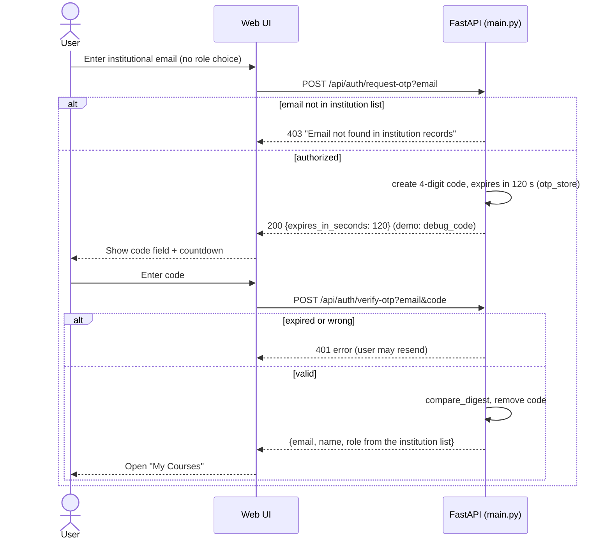
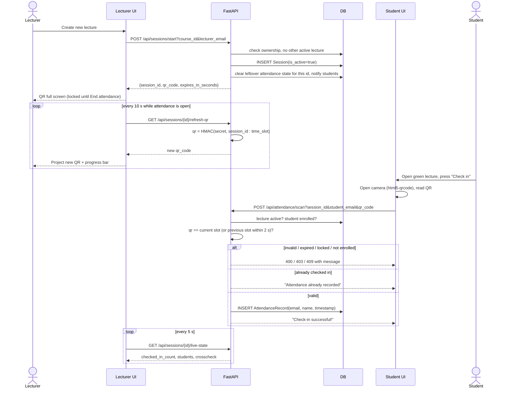
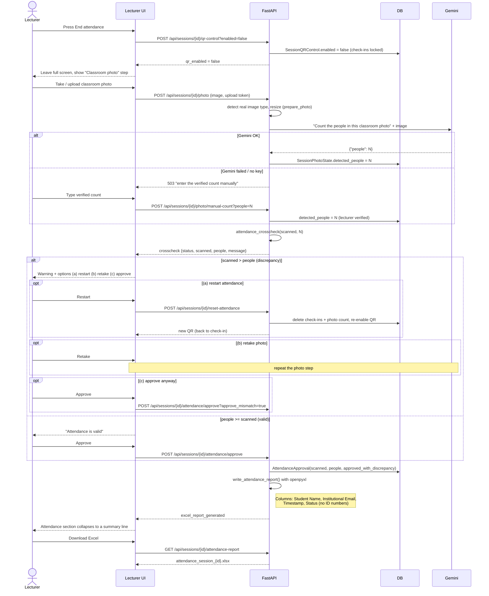
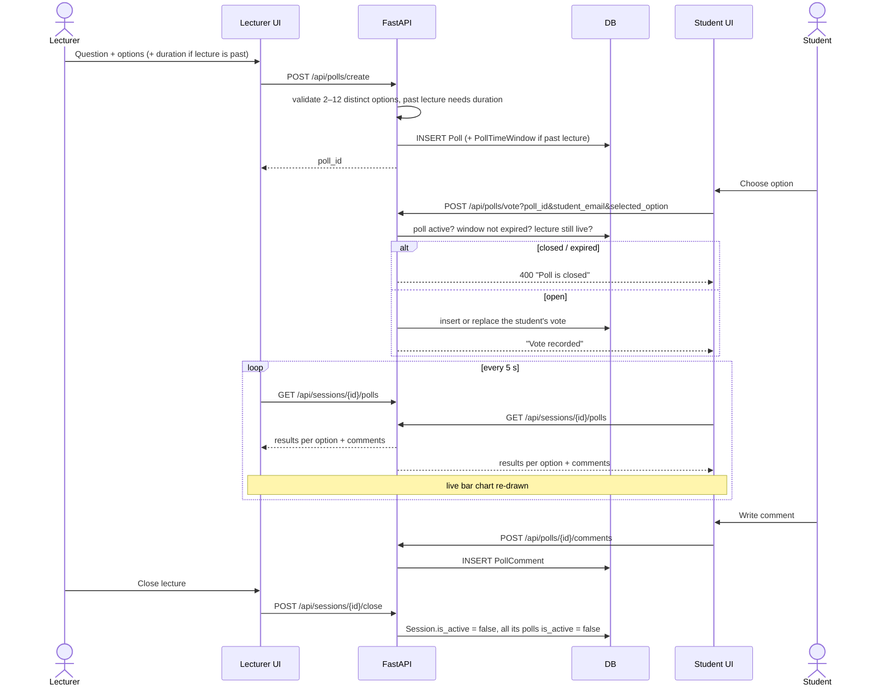
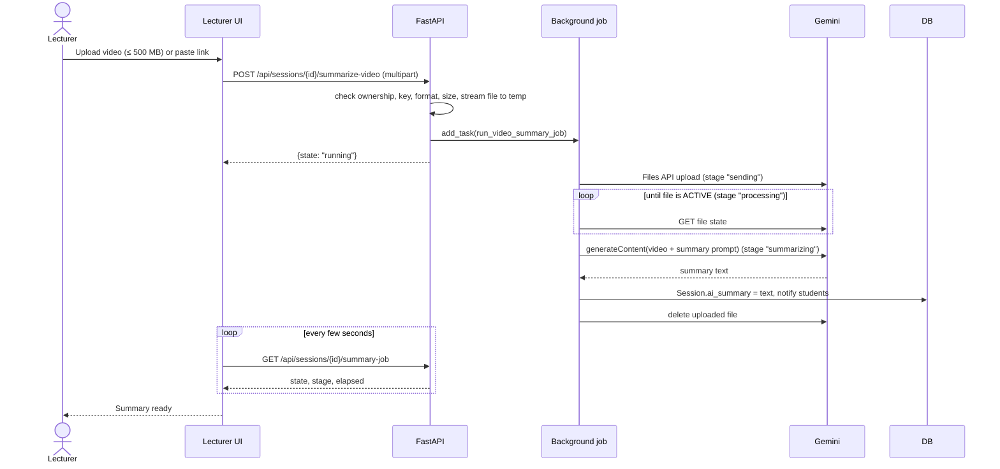
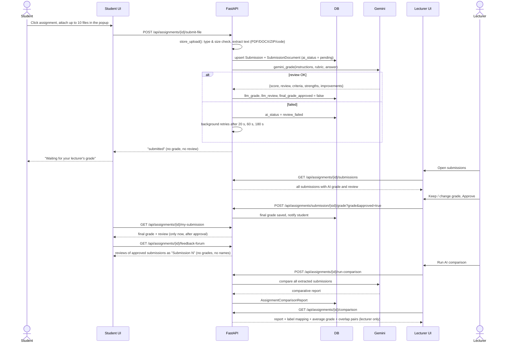

# Sequence Diagrams: SmartClass

The diagrams below show how the main flows run through the system. Participant names match the code:

| Participant | In the code |
|---|---|
| Student UI / Lecturer UI | `index.html` (single page, polls the API every 5 s) |
| API | `main.py` (FastAPI endpoints) |
| DB | `database.py` + `models.py` (SQLAlchemy, SQLite) |
| Gemini | Google Gemini REST API (`gemini_generate`, Files API) |

Each diagram references the use case (`Use Cases.md`) it implements.

---

## 1. Login with OTP (UC-1)

---

## 2. Start lecture and student QR check-in (UC-5, UC-6)

---

## 3. End attendance (SESSION END), classroom photo, cross-check and Excel (UC-7 – main flow)

---

## 4. Live poll (UC-9, UC-10)

---

## 5. AI lecture summary (UC-11)

---

## 6. Assignment submission, AI review, approval and comparison (UC-14, UC-15, UC-17)

