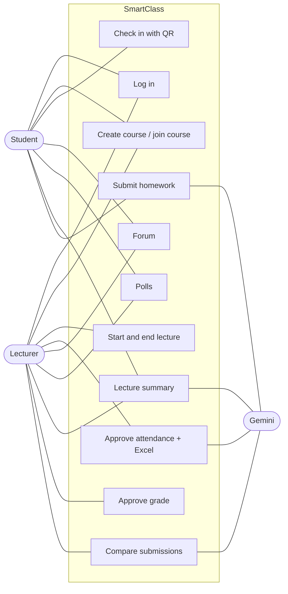
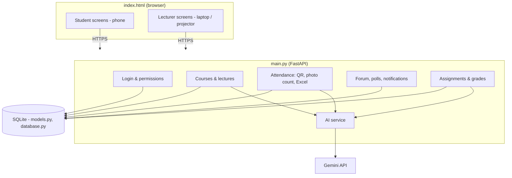

# Use Cases & Main Components

## 1. Client stories
| # | As a… | I want to… | So that… |
|---|---|---|---|
| 1 | lecturer | take attendance with a QR and one photo | I don't waste class time |
| 2 | lecturer | get a warning when there are more check-ins than people | students can't check in for friends |
| 3 | lecturer | download attendance as Excel | I have a record |
| 4 | student | check in by scanning with my phone | it takes a few seconds |
| 5 | student | ask a question during or after class | I don't have to interrupt |
| 6 | lecturer | run a quick poll and see the results live | I know if the class understood |
| 7 | lecturer | get a summary from the recording | students get notes without extra work |
| 8 | student | read the summary of a lecture I missed | I can catch up |
| 9 | student | get a detailed review of my homework | I know what to improve |
| 10 | lecturer | approve or change the AI grade | the final grade is my decision |
| 11 | lecturer | compare all submissions | I see common mistakes and copying |

## 2. Use case diagram

## 3. Main use cases

### UC-1: Take attendance (main)
**Actors:** lecturer, students, Gemini

1. The lecturer starts a lecture. The QR opens full screen on the projector.
2. Students scan it with their phones and are checked in.
3. The lecturer presses **End attendance**. Check-in is locked.
4. The lecturer takes a photo of the class. Gemini counts the people.
5. The app compares check-ins with people in the photo.
6. If it's OK, the lecturer approves and downloads the Excel.

**Other cases:**
- More check-ins than people → warning: restart attendance / retake photo / approve anyway.
- Gemini fails → the lecturer types the number.
- A student came late → "Reopen check-ins".

### UC-2: Check in
**Actor:** student

1. The student opens the live lecture and presses "Scan the QR code".
2. Scans the QR on the board.
3. Sees "Check-in successful".

**Errors:** old code, not in the course, attendance closed, already checked in.

### UC-3: Ask in the forum
**Actors:** student, lecturer
1. The student writes a question in the lecture forum (also after class).
2. The lecturer or another student replies. The author gets a notification.

### UC-4: Run a poll
**Actors:** lecturer, students
1. The lecturer writes a question and options.
2. Students vote and the chart updates live.
3. The poll closes when the lecturer closes it or ends the lecture. On a past lecture it closes after the time limit.

### UC-5: Get a lecture summary
**Actors:** lecturer, Gemini, students
1. The lecturer uploads the recording or a YouTube link.
2. Gemini writes the summary in the background (a few minutes for a long video).
3. The lecturer can edit it. Students read it on the lecture page.

### UC-6: Submit homework and get a grade
**Actors:** student, Gemini, lecturer
1. The student clicks the assignment and attaches files.
2. Gemini reviews the work and suggests a grade. Only the lecturer sees it.
3. The student sees "Waiting for your lecturer's grade".
4. The lecturer approves the grade or changes it.
5. The student sees the grade and the review. The review (no name, no grade) goes to the class feedback forum.

**Other cases:** Gemini busy → the app retries by itself, and the lecturer can re-run it.

## 4. Main software components

| Component | What it does |
|---|---|
| **Client** (`index.html`) | One page for both roles. Mobile-first for students, big screens for the lecturer. Refreshes every 5 seconds. |
| **Login & permissions** | Checks the email list, creates and checks the one-time code, and checks that the user belongs to the course. |
| **Courses & lectures** | Course IDs, joining, starting and ending lectures. |
| **Attendance** | Creates the QR (changes every 10 s), checks scans, sends the photo to Gemini, compares the numbers, creates the Excel. |
| **Forum, polls, notifications** | Posts and replies, votes and live results, notifications. |
| **Assignments & grades** | Uploads, reading PDF/Word/ZIP, AI review, lecturer approval, comparison. |
| **AI service** | All calls to Gemini, with retries and a backup model. |
| **Database** | SQLite through SQLAlchemy. Files and Excel reports are saved in the data folder. |
