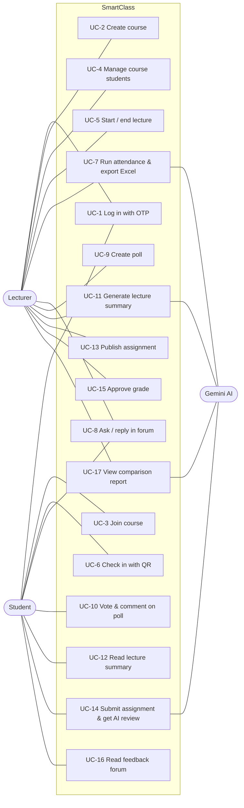

# Use Cases & Client Stories: SmartClass

This document describes the main use cases of SmartClass. Each use case is linked to the requirements in `SRS.md` (FR-x.y).

## 1. Actors

| Actor | Type | Goal |
|---|---|---|
| **Lecturer** | Primary | Run the class: attendance, Q&A, polls, summaries, assignments. |
| **Student** | Primary | Check in, take part in the lecture, learn from summaries and feedback. |
| **AI Service (Google Gemini)** | Secondary (system) | Count people in a photo, summarize a video, review and compare assignments. |
| **Institution** | Secondary (offline) | Provide the list of authorized users and roles. |

## 2. Use Case Diagram

## 3. Client Stories (summary)

| # | As a… | I want to… | So that… |
|---|---|---|---|
| CS-1 | lecturer | take attendance with one QR on the screen and one photo | I don't waste class time calling names |
| CS-2 | lecturer | be warned when there are more check-ins than people in the room | students can't check in for absent friends |
| CS-3 | lecturer | download an Excel attendance sheet without ID numbers | I keep a record and respect privacy |
| CS-4 | student | check in by scanning a code with my phone | it takes a few seconds and needs no app install |
| CS-5 | student | ask a question during or after the lecture | I don't need to interrupt or wait for office hours |
| CS-6 | lecturer | launch a quick poll and see a live chart | I know right away if the class understood |
| CS-7 | lecturer | open a poll after class with a deadline | students can review the material at home |
| CS-8 | lecturer | upload the lecture recording and get a summary | students get notes without extra work from me |
| CS-9 | student | read summaries of all lectures | I can catch up on a lecture I missed |
| CS-10 | student | get an AI review and recommended grade right after I submit | I know what to improve |
| CS-11 | lecturer | approve or change the AI grade | the final grade is still my decision |
| CS-12 | student | read the feedback given to others (without grades) | I learn from my classmates' mistakes |
| CS-13 | lecturer | see a comparison of all submissions | I find common gaps and suspicious similarity |

## 4. Detailed Use Cases

### UC-1: Log in with OTP
| | |
|---|---|
| **Actors** | Lecturer, Student |
| **Precondition** | The user's institutional email is in the authorized list. |
| **Main flow** | 1. User chooses Student or Lecturer login. 2. User enters institutional email. 3. System creates a 4-digit OTP valid for 120 s and sends it (demo: shows it on screen). 4. User enters the code. 5. System verifies it and opens "My Courses" with the user's role. |
| **Alternative flows** | 2a. Email not authorized → "Email not found in institution records". 4a. Wrong code → error, user can retry. 4b. Code expired → user presses "resend code". |
| **Postcondition** | User is logged in. |
| **Requirements** | FR-1.1 – FR-1.5 |

### UC-2: Create course
| | |
|---|---|
| **Actor** | Lecturer |
| **Precondition** | Logged in as lecturer. |
| **Main flow** | 1. Lecturer presses "Create course". 2. Enters name and description. 3. System generates a unique Course ID (`CRS-xxxxxx`) and shows the course in the list. 4. Lecturer gives the Course ID to the class. |
| **Alternative flows** | 2a. Empty name → "Course name cannot be empty". |
| **Requirements** | FR-2.1, FR-2.2 |

### UC-3: Join course
| | |
|---|---|
| **Actor** | Student |
| **Main flow** | 1. Student presses "Join course" in "My Courses". 2. Enters the Course ID. 3. System adds the student to the course and shows it in the list. |
| **Alternative flows** | 2a. Unknown Course ID → "Course not found". 2b. Already a member → "You are already enrolled". |
| **Requirements** | FR-2.3, FR-2.4 |

### UC-4: Manage course students
| | |
|---|---|
| **Actor** | Lecturer |
| **Main flow** | 1. Lecturer opens the course student list. 2. Adds a student by institutional email, or removes a student. |
| **Alternative flows** | 2a. Email is not a registered student → error. 2b. Student already enrolled → informative message. |
| **Requirements** | FR-2.5 |

### UC-5: Start / end lecture
| | |
|---|---|
| **Actor** | Lecturer |
| **Main flow** | 1. Lecturer presses "Create new lecture". 2. System creates an active (green) lecture, starts the dynamic QR and notifies students. … 3. At the end the lecturer closes the lecture; it turns grey and its live polls close. |
| **Alternative flows** | 1a. A lecture is already active → the system opens the existing one instead of creating a duplicate. 3a. Attendance not yet verified → system asks for a photo count or explicit approval first. |
| **Requirements** | FR-3.1 – FR-3.3 |

### UC-6: Check in with QR
| | |
|---|---|
| **Actor** | Student |
| **Precondition** | Student is a member of the course; the lecture is active; check-in is open. |
| **Main flow** | 1. Student opens the green lecture and presses "Check in". 2. Phone camera opens; student scans the QR on the projector. 3. System validates the code and records the check-in with a timestamp. 4. Student sees "Check-in successful". |
| **Alternative flows** | 3a. Code older than 10 s (+2 s grace) → "QR code expired. Scan the newest code". 3b. Not a course member → "Please join this course". 3c. Lecturer already pressed SESSION END → "Attendance QR is paused". 3d. Already checked in → "Attendance already recorded". |
| **Postcondition** | One attendance record for the student in this lecture. |
| **Requirements** | FR-4.3 – FR-4.5 |

### UC-7: Run attendance and export Excel *(main use case)*
| | |
|---|---|
| **Actors** | Lecturer, Gemini AI |
| **Precondition** | Active lecture; students have checked in (UC-6). |
| **Main flow** | 1. Lecturer projects the dynamic QR; the live count grows. 2. Lecturer presses **SESSION END**; check-ins are locked. 3. Lecturer takes a classroom photo (laptop camera, file, or phone via an upload QR). 4. System sends the photo to Gemini and gets the number of people. 5. System cross-checks check-ins vs. people. 6. If people ≥ check-ins, the list is valid; lecturer presses **Approve**. 7. System generates the Excel report (name, email, time, status). 8. Lecturer downloads the report. |
| **Alternative flows** | 5a. **Check-ins > people** → system shows a discrepancy warning with three options: **(a)** restart attendance (check-ins deleted, new QR round, back to step 1); **(b)** retake the photo (back to step 3); **(c)** approve anyway and export (step 7, marked "approved with discrepancy"). 4a. AI counting fails or no key → system asks the lecturer to type a verified count; it never invents a number. 4b. Lecturer corrects the AI count manually → cross-check runs again. |
| **Postcondition** | Approved attendance and an `.xlsx` report saved on the server. |
| **Requirements** | FR-4.1 – FR-4.16 |

### UC-8: Ask / reply in the lecture forum
| | |
|---|---|
| **Actors** | Student, Lecturer |
| **Main flow** | 1. User opens a lecture (active or past). 2. Writes a question or suggestion and posts it. 3. Lecturer or another student replies in the thread. 4. Author and lecturer are notified. |
| **Alternative flows** | 2a. Empty message → rejected. 2b. Not a course member → rejected. |
| **Requirements** | FR-5.1 – FR-5.4 |

### UC-9: Create poll
| | |
|---|---|
| **Actor** | Lecturer |
| **Main flow (live)** | 1. In an active lecture the lecturer writes a question and 2–12 options (single or multiple answer). 2. System publishes the poll and notifies students. 3. Lecturer watches the live chart. 4. Lecturer closes the poll (or the lecture) → voting locks. |
| **Main flow (after class)** | 1. In a past lecture the lecturer creates a poll and **must** set a duration (1 min – 7 days). 2. Voting is allowed until the time expires. |
| **Alternative flows** | 1a. Fewer than 2 options or duplicate options → error. 1b. Past-lecture poll without a duration → error. |
| **Requirements** | FR-6.1 – FR-6.4 |

### UC-10: Vote and comment on a poll
| | |
|---|---|
| **Actor** | Student |
| **Main flow** | 1. Student opens the poll. 2. Chooses an option; the chart updates. 3. (Optional) writes a comment in the discussion thread. |
| **Alternative flows** | 2a. Poll closed / lecture ended / time expired → "Poll is closed". 2b. Student changes their vote → the old vote is replaced (single-answer). |
| **Requirements** | FR-6.2, FR-6.3, FR-6.5, FR-6.6 |

### UC-11: Generate lecture summary
| | |
|---|---|
| **Actors** | Lecturer, Gemini AI |
| **Main flow** | 1. Lecturer opens a lecture and uploads the video file (≤ 500 MB) or pastes a recording link. 2. System starts a background job and shows the stage: sending → processing → summarizing. 3. Gemini returns the summary; the system saves it on the lecture. 4. Students are notified. |
| **Alternative flows** | 1a. Unsupported format or > 500 MB → error. 1b. Unsupported link → system asks to upload the file. 2a. A job is already running → "already being generated". 3a. Gemini error → job ends with a readable error; lecturer can retry. |
| **Requirements** | FR-7.1 – FR-7.5 |

### UC-12: Read lecture summary
| | |
|---|---|
| **Actor** | Student |
| **Main flow** | 1. Student opens a past lecture. 2. Reads the summary text. |
| **Requirements** | FR-7.4 |

### UC-13: Publish assignment
| | |
|---|---|
| **Actor** | Lecturer |
| **Main flow** | 1. Lecturer presses "Create new assignment". 2. Enters title, instructions, due date, optional rubric and brief file. 3. System saves the assignment and notifies students. |
| **Alternative flows** | 2a. Missing title/instructions or invalid date → error. Lecturer can later edit or delete the assignment. |
| **Requirements** | FR-8.1 |

### UC-14: Submit assignment and get AI review
| | |
|---|---|
| **Actors** | Student, Gemini AI |
| **Main flow** | 1. Student opens the assignment and uploads a file. 2. System stores the file and extracts its text. 3. Gemini reviews it against the instructions and rubric and returns a score and a deep review. 4. Student sees the recommended grade (marked "pending lecturer approval") and the review. 5. The verbal review (without grade) appears anonymously in the feedback forum. |
| **Alternative flows** | 1a. Unsupported type or > 50 MB → error. 3a. Gemini fails → status "review failed"; system retries automatically 3 times; lecturer can re-run. 3b. No API key → status "pending configuration" (no fake grade). 1b. Student resubmits → previous submission and review are replaced. |
| **Requirements** | FR-8.2 – FR-8.5, FR-8.7 |

### UC-15: Approve grade
| | |
|---|---|
| **Actor** | Lecturer |
| **Main flow** | 1. Lecturer opens the submissions list. 2. Reads the AI review, keeps or changes the grade (0–100). 3. Presses Approve. 4. Student is notified and sees the final grade. |
| **Requirements** | FR-8.4 |

### UC-16: Read feedback forum
| | |
|---|---|
| **Actor** | Student |
| **Main flow** | 1. Student opens the assignment's feedback forum. 2. Reads the reviews of all submissions, labelled "Submission N", with no grades or names. |
| **Requirements** | FR-8.5 |

### UC-17: View comparison report
| | |
|---|---|
| **Actors** | Lecturer, Gemini AI |
| **Precondition** | At least two readable submissions. |
| **Main flow** | 1. Lecturer presses "Run AI comparison". 2. Gemini compares all submissions (quality, strengths, weaknesses, similarity). 3. Lecturer sees the report, the label→student mapping, the average recommended grade and the top text-overlap pairs. |
| **Alternative flows** | 1a. Fewer than two submissions → error. 3a. New submissions arrived after the report → marked "not fresh", lecturer can re-run. |
| **Postcondition** | Report visible to the lecturer only. |
| **Requirements** | FR-8.6, FR-8.8 |
